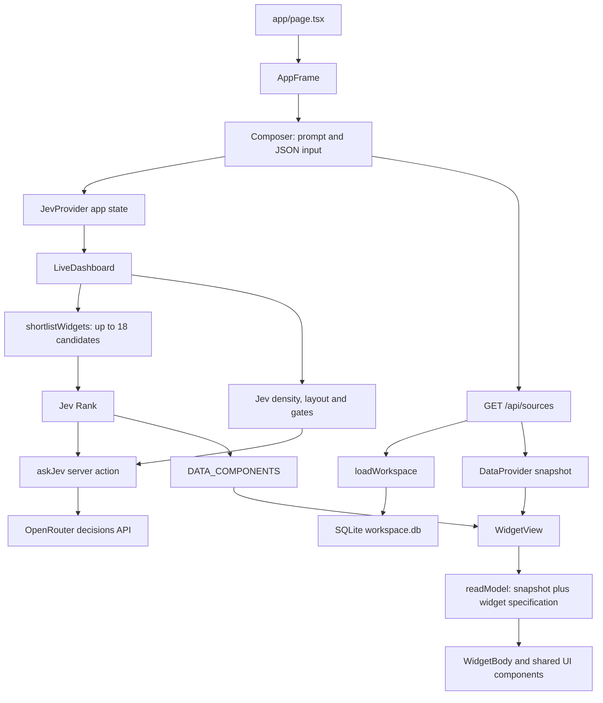

# JEV Interfaces codebase map

Reviewed 2026-10-10 from the local source and installed dependencies. This document describes the current implementation; it does not imply that the live model integration has been exercised.

## Purpose and scope

JEV Interfaces is a single-page dashboard prototype. A user describes a dashboard, a local keyword matcher shortlists predefined widgets, and Jev chooses their relevance, layout, density, and optional controls. The widgets render deterministic data from a local, seeded SQLite database.

The active registry contains **135 widget definitions**, **27 rendering kinds**, and **19 data slices**. These definitions share renderers; they are not 135 independently implemented visual components. The UI inventory lists 38 shadcn-style primitives.

The application uses Next.js 15, React 19, TypeScript with strict checking, Tailwind CSS 4, Radix UI, Recharts, and `jev-ui` 0.0.2. Zod is used by the older binding system. There is one page, one data route, and one exported server action.

## Runtime flow

`app/layout.tsx` installs global styles, tooltips, notifications, and the providers. `app/providers.tsx` nests JevProvider inside DataProvider. AppFrame supplies the source selector, prompt sidebar, dashboard canvas, and decision inspector.
INSERT INTO monthly_revenue (month, revenue, costs) VALUES ('Jul', 76000, 36000);

INSERT INTO customers (id, name, region, amount, status)
VALUES ('8', 'Soylent', 'NA', 9100, 'Active');

INSERT INTO invoice_lines (number, client, due, item, qty, price)
VALUES ('INV-2048', 'Acme Corp', '2026-10-15', 'Extra seats', 4, 99);

INSERT INTO tasks (column_id, column_title, title)
VALUES ('todo', 'To do', 'Write seed script');

INSERT INTO team (name, role, status)
VALUES ('Sam Patel', 'Support', 'online');

INSERT INTO activity (who, action, when_label)
VALUES ('Sam', 'closed ticket #18', '5m ago');

INSERT INTO reviews (author, rating, text)
VALUES ('Lina', 5, 'Clear revenue view.');

INSERT INTO regions (region, value) VALUES ('LATAM', 12);

INSERT INTO services (name, status) VALUES ('Billing', 'ok');

INSERT INTO funnel (stage, value, ord) VALUES ('Retained', 210, 5);
Composer maintains immediate textarea state and publishes it into Jev's `app` state after 200 ms. That state includes `prompt`, `dataPreview`, `hasStructuredData`, and `parsedData`. A separate 200 ms effect fetches workspace data when the prompt is nonempty and the JSON textarea is empty. It aborts superseded requests.

DataProvider holds `source`, `snapshot`, and `loading` independently from Jev state. Changing the source refetches the snapshot and changes shortlist hints. It does not perform SQL filtering.

LiveDashboard asks Jev for a density score corresponding to 2, 4, 6, or 8 tiles. Branch selects one of four CSS grid templates: hero plus rail, equal grid, full-width stack, or four-column KPI-style grid. These are presentation templates, not semantic placement algorithms. Gate controls visibility of Export, Filters, and a help message.

shortlistWidgets scores substring matches against widget metadata and source hints. With at least six matches it takes the best 18. Otherwise it replaces the hits with a registry-order fallback. Rank then grades candidates against four relevance levels, filters at 0.35, and applies the density limit after successful resolution.

The installed Jev dependency batches decisions queued in the same microtask. Rank can retain a previous result while re-ranking, provided its widget IDs still exist in the candidate set. Before a successful result, its fallback can return every candidate, bypassing the eventual tile limit. The density hook runs even when the canvas has no prompt.

## Module ownership

| Area | Files | Responsibility |
| --- | --- | --- |
| Page and composition | `app/page.tsx`, `app/layout.tsx`, `app/providers.tsx`, `components/AppFrame.tsx` | Application entry and provider treeINSERT INTO monthly_revenue (month, revenue, costs) VALUES ('Jul', 76000, 36000);

INSERT INTO customers (id, name, region, amount, status)
VALUES ('8', 'Soylent', 'NA', 9100, 'Active');

INSERT INTO invoice_lines (number, client, due, item, qty, price)
VALUES ('INV-2048', 'Acme Corp', '2026-10-15', 'Extra seats', 4, 99);

INSERT INTO tasks (column_id, column_title, title)
VALUES ('todo', 'To do', 'Write seed script');

INSERT INTO team (name, role, status)
VALUES ('Sam Patel', 'Support', 'online');

INSERT INTO activity (who, action, when_label)
VALUES ('Sam', 'closed ticket #18', '5m ago');

INSERT INTO reviews (author, rating, text)
VALUES ('Lina', 5, 'Clear revenue view.');

INSERT INTO regions (region, value) VALUES ('LATAM', 12);

INSERT INTO services (name, status) VALUES ('Billing', 'ok');

INSERT INTO funnel (stage, value, ord) VALUES ('Retained', 210, 5); |
| Input and source state | `components/Composer.tsx`, `components/data-provider.tsx` | Prompt debounce, JSON parsing, source loading |
| UI decisions | `components/LiveDashboard.tsx`, `components/InspectorStrip.tsx` | Layout, density, widget ranking, decision metadata |
| Model transport | `app/actions.ts` | OpenRouter request, answer normalization, usage metadata |
| Data API | `app/api/sources/route.ts` | Validate source ID, return workspace snapshot |
| Persistence | `lib/db/workspace.ts` | SQLite connection, schema, initial sample rows |
| Data contract and loading | `lib/sources/types.ts`, `lib/sources/workspace.ts` | Snapshot types and SQL-to-object mapping |
| Widget registry | `lib/widgets/definitions.ts`, `lib/widgets/shortlist.ts` | Widget identity, relevance descriptions, candidate selection |
| Widget data | `lib/widgets/model.ts` | Shared view model and calculated metrics |
| Widget rendering | `components/widgets/library.tsx`, `components/widgets/WidgetView.tsx` | Generated component registry and rendering switch |
| Shared visuals | `components/library/charts.tsx`, `data-display.tsx`, `tile-shell.tsx` | Recharts wrappers, record table, card shell |
| Primitive UI | `components/ui/`, `lib/utils.ts`, `app/globals.css` | Radix wrappers, styles, class merging, theme tokens |
| Legacy tile system | `lib/catalog.ts`, `lib/bind.ts`, `lib/samples.ts`, `lib/sources/payload.ts`, `components/tiles/TileRenderer.tsx`, `components/library/metrics.tsx` | Older 30-tile catalog, JSON binding, sample fallback |

The legacy TileRenderer has no caller in the active application. Its JSON binding and sample fallback therefore do not apply to the current dashboard. Shared charts, tables, and shells are still used by both systems.

## Data and server boundaries

`getDb()` opens `.data/workspace.db` using Node's synchronous SQLite API and keeps a module-level connection. It creates 11 tables: monthly_revenue, customers, invoice_lines, tasks, team, activity, reviews, regions, sla, services, and funnel. Seeding is skipped when the customers table already contains rows. There is no migration framework or seed transaction.
INSERT INTO monthly_revenue (month, revenue, costs) VALUES ('Jul', 76000, 36000);

INSERT INTO customers (id, name, region, amount, status)
VALUES ('8', 'Soylent', 'NA', 9100, 'Active');

INSERT INTO invoice_lines (number, client, due, item, qty, price)
VALUES ('INV-2048', 'Acme Corp', '2026-10-15', 'Extra seats', 4, 99);

INSERT INTO tasks (column_id, column_title, title)
VALUES ('todo', 'To do', 'Write seed script');

INSERT INTO team (name, role, status)
VALUES ('Sam Patel', 'Support', 'online');

INSERT INTO activity (who, action, when_label)
VALUES ('Sam', 'closed ticket #18', '5m ago');

INSERT INTO reviews (author, rating, text)
VALUES ('Lina', 5, 'Clear revenue view.');

INSERT INTO regions (region, value) VALUES ('LATAM', 12);

INSERT INTO services (name, status) VALUES ('Billing', 'ok');

INSERT INTO funnel (stage, value, ord) VALUES ('Retained', 210, 5);
Every nonempty data request reads the entire workspace. Prompt regexes only determine the `matched` labels. The loader sorts customers by amount and selects the first invoice by invoice number; it does not interpret requested customers, invoice numbers, periods, or filters. Monthly revenue has no explicit SQL ordering. Its last two returned rows are treated as the current and previous months.

The server action sends decisions to `https://openrouter.ai/api/alpha/decisions`. It uses server-side `OPENROUTER_API_KEY` and `JEV_MODEL`, defaulting to `typesafe/jev-1.13`. It normalizes choice, score, and noul answers and returns latency, token usage, and cost metadata when available. Missing answers and unsuccessful responses throw errors. There is no application-level timeout or retry.

Jev receives the prompt and application state, including pasted JSON. The SQLite snapshot is held in a separate provider and is not added to the decision payload. The installed Branch and Rank implementations accept `pick` in their declarations but do not forward it at runtime; their decisions use the dependency's default state channels.

There is no application authentication, tenant boundary, write API, dashboard persistence, external data connector, or background refresh loop. Local SQLite data persists; prompt and dashboard state are in memory. Deployment needs a Node runtime supporting `node:sqlite` and writable storage for the database.

## Confirmed behavior gaps

1. **JSON override disconnect:** Composer clears the snapshot whenever any JSON text is present. WidgetView only reads the snapshot and never reads `parsedData`, leaving selected widgets in their waiting state. Invalid JSON also disables loading despite the prose-only fallback message.
2. **Customer metric mismatches:** `customer-count` and `average-deal` both show the full booked amount. `largest-account` shows the top-five sum. With the current database these are $91,900, $91,900, and $78,300 respectively. `at-risk-count` retains a dollar unit.
3. **Region code mismatch:** customer records use `NA` and `EU`, but the model searches for names starting with `North` and `Europe`; those headline widgets return zero.
4. **Incomplete view models:** `region-ranked` has no items for the ranked renderer. Other descriptions also overpromise: review ranking is not sorted by rating, and month comparison includes all months rather than just the latest two.
5. **Funnel progress mismatch:** `funnel-progress` describes activation but uses the rounded paid conversion percentage as its numerator and the visitor count as its denominator, producing 0% progress for the seeded values.
6. **Placeholder actions:** Export and Filters have no event handlers. Checklists are disabled and kanban cards have no editing or drag behavior.
7. **Loading state can stick:** aborting an in-flight source request skips its loading reset; clearing the prompt or entering JSON does not reset loading either.
8. **Chart color mismatch:** chart helpers wrap complete OKLCH theme values in `hsl(...)`. Pie slices also do not explicitly consume the generated color variables. These are source-level findings; browser appearance was not tested.
9. **Weak shortlist fallback:** fewer than six matches discards relevant hits. Registry ordering heavily favors metrics in the fallback despite its diversity comment.
10. **Broad lint command includes generated output:** the ESLint configuration does not exclude `.next` and the generated Next declaration file.

The current sample prompt asking for Q3 versus last year exceeds the available Jan–Jun sample revenue data. The prompt can select widgets but cannot create missing periods or data.

## Verification and working commands

- TypeScript: `./node_modules/.bin/tsc --noEmit --incremental false` passed.
- Source lint: `./node_modules/.bin/eslint app components lib next.config.ts eslint.config.mjs postcss.config.mjs` passed.
- Default `npm run lint` failed with 725 errors and 15,289 warnings, including generated `.next` files and `next-env.d.ts`.
- Read-only SQLite inspection confirmed all 11 tables. An in-memory TypeScript evaluation of readModel, using current customer records, confirmed the customer and region metric mismatches.
- No application test suite, test script, CI configuration, or project README was found. The workspace is not currently inside a Git repository.
- No production build, browser interaction test, or live OpenRouter request was run. No application source was changed during this review.

Scripts are `npm run dev` (Next with Turbopack), `npm run build`, `npm start`, and `npm run lint`. Environment variable names and the default model are documented in `.env.example`.

## Where future changes belong

- Add a widget using an existing rendering kind and data slice: add its specification in `lib/widgets/definitions.ts`; component registration is automatic.
- Add or correct a metric: update `lib/widgets/model.ts` and check its actual displayed unit and denominator.
- Add a visual representation: extend WidgetKind and WidgetBody, reusing shared UI components.
- Add a source: update source types, loader/database mapping, source hints, and the relevant model slices.
- Change AI selection: update shortlist matching, widget descriptions, or LiveDashboard questions and thresholds.
- Restore JSON override: establish a validated JSON-to-model or JSON-to-snapshot path in the active widget system and align Composer's loading behavior with it.
- Change styling: start with global theme tokens, primitive wrappers, shared chart helpers, and TileShell.
